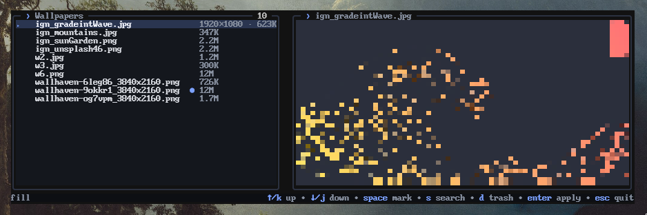

<h1>walltui</h1>

<p><em>Keyboard-driven wallpaper picker for sway.</em></p>

<p>
  <a href="https://github.com/jdcasdev/walltui/releases/latest"></a>
  <a href="https://github.com/jdcasdev/walltui/actions/workflows/ci.yml"></a>
  
  <a href="LICENSE"></a>
</p>

<p>
  
</p>

## What it is

Pick a wallpaper in the terminal. walltui applies it with `swaybg` and
remembers it for the next login.

- Arrows move. `s` searches. `enter` applies.
- `d` sends wallpapers to the trash.
- A failed apply leaves the current wallpaper.

## Install

```sh
go install github.com/jdcasdev/walltui/cmd/walltui@latest   # -> ~/go/bin/walltui
```

Needs `swaybg`. Needs `gio` for `d`.

From a clone:

```sh
make build                                  # -> bin/walltui
sudo install -m755 bin/walltui /usr/local/bin/walltui
```

## Wallpaper at login

In your sway config:

```
swaybg_command -
exec ~/go/bin/walltui apply
```

## Usage

```sh
walltui              # open the picker
walltui apply        # no TUI: the stored wallpaper, or the first one
walltui apply PATH   # a specific wallpaper
walltui --version
```

| key                         | action                                 |
|-----------------------------|----------------------------------------|
| `↑`/`k`, `↓`/`j`            | move                                   |
| `pgup`/`pgdn`, `home`/`end` | jump                                   |
| `space`                     | mark                                   |
| `enter`                     | apply                                  |
| `s`                         | search, `enter` applies, `esc` cancels |
| `d`                         | trash: marked, or the cursor's         |
| `esc`, `ctrl+c`             | quit                                   |

## Configuration

| variable         | default                 | meaning                                    |
|------------------|-------------------------|--------------------------------------------|
| `WALLPAPER_DIR`  | `~/Pictures/Wallpapers` | the library, scanned recursively           |
| `WALLPAPER_MODE` | `fill`                  | `fill`, `fit`, `stretch`, `center`, `tile` |
| `XDG_STATE_HOME` | `~/.local/state`        | state directory                            |

State (`current`, `apply.lock`, `swaybg.pid`) lives in
`~/.local/state/walltui/`. Only `swaybg` is supported today.

Tests: `make test`, `make race`, `make lint`.

## License

MIT. Keep the copyright line and that's it.
